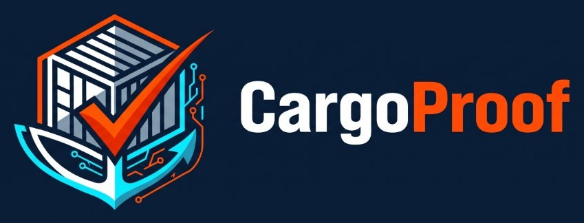
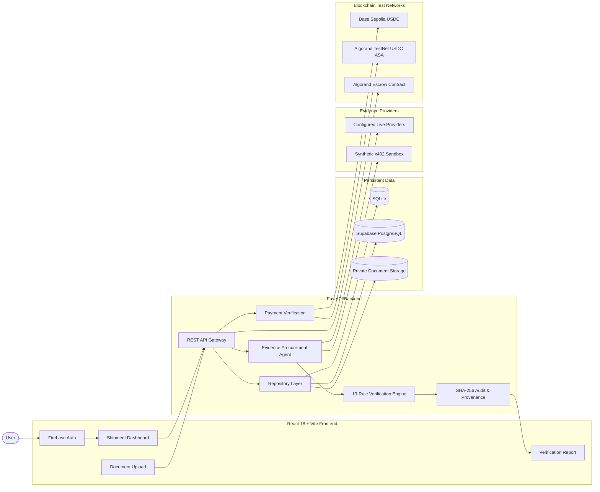
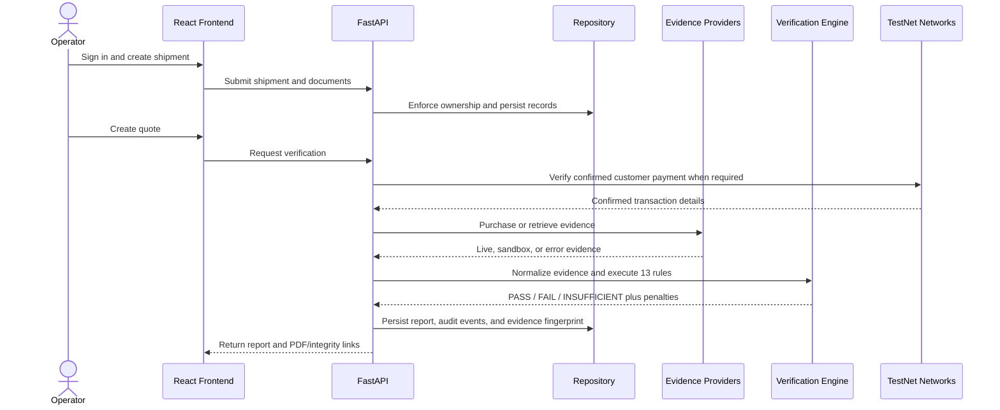
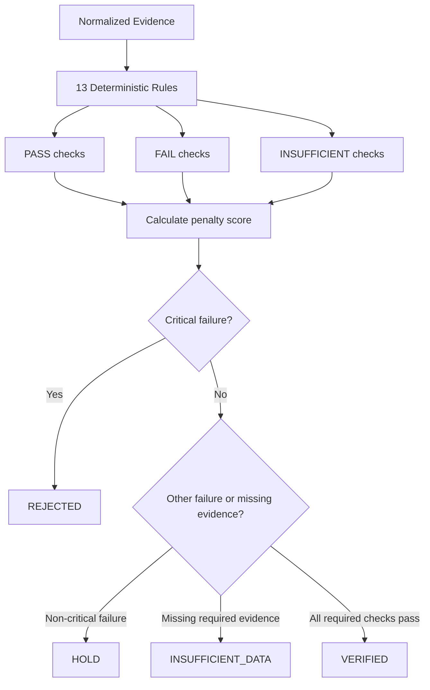

# CargoProof AI

<div align="center">
  

  **Evidence-based shipment verification for transparent international trade**

  [](frontend)
  [](backend)
  [](#testnet-payments)
</div>

CargoProof AI is a full-stack shipment intelligence platform that collects shipment evidence, applies deterministic verification rules, records tamper-evident report fingerprints, and validates TestNet payments before paid verification workflows.

> **Trust boundary:** Synthetic documents, sandbox evidence, demo mode, and TestNet transactions are not real cargo evidence, real payments, or production shipment clearance.

---

## Why CargoProof AI?

International shipment verification often combines documents from different parties, live or delayed vessel data, manual checks, and fragmented payment records. CargoProof AI brings these pieces into a traceable workflow:

- Upload private PDF, PNG, or JPEG shipment documents.
- Validate shipment ownership and document fingerprints with SHA-256.
- Extract document fields from text-based PDFs.
- Apply a deterministic 13-rule verification engine.
- Preserve evidence provenance and source references.
- Verify Base Sepolia and Algorand TestNet payments on-chain.
- Generate downloadable PDF reports and audit history.
- Clearly label synthetic and mixed evidence sources.

---

## Core Features

| Area | Capability |
|---|---|
| Authentication | Firebase email/password and Google sign-in; server-side Firebase ID-token verification |
| Shipment intake | Shipment, quote, container, IMO, route, booking, bill of lading, and cargo fields |
| Documents | PDF/PNG/JPEG upload, SHA-256 fingerprints, private storage, ownership checks, text extraction |
| Verification | Deterministic PASS / FAIL / INSUFFICIENT rule evaluation and 13-rule reports |
| Evidence | Configurable live-provider adapters and clearly labeled sandbox evidence |
| Payments | Verified Base Sepolia USDC receipts and Algorand TestNet USDC ASA payments |
| x402 | Algorand TestNet payment requirement validation and settlement receipt handling |
| Escrow | PyTeal reference contract, on-chain state read, and operator-controlled actions |
| Reports | HTML history, PDF export, evidence integrity checks, provenance, and audit events |

---

## System Architecture



### Verification Workflow



### Decision Flow



The 0–100 risk value is a severity-weighted rule penalty score, not a probability:

- Passing and sufficient evidence does not add a risk penalty.
- Missing evidence receives a reduced penalty.
- Critical, high, medium, and low failures receive configured weights.
- `VERIFIED` requires all required checks to pass.

---

## Technology Stack

| Layer | Technology |
|---|---|
| Frontend | React 18, Vite 5, React Router, Firebase SDK, Lucide React |
| Backend | Python 3.11+, FastAPI, Pydantic v2, HTTPX, Uvicorn |
| Authentication | Firebase Authentication + Firebase Admin SDK |
| Data | SQLite locally; Supabase PostgreSQL/PostgREST when configured |
| Documents | PyPDF extraction, ReportLab PDFs, SHA-256 hashing |
| Live evidence | Operator-configured provider adapters; provider paths are not invented |
| Payments | Web3.py for Base Sepolia; py-algorand-sdk/x402-avm for Algorand |
| Contracts | PyTeal reference escrow contract and confirmed-state CLI |

---

## Quick Start on Windows

### Prerequisites

- Python 3.11+
- Node.js 20+
- PowerShell
- Git

### 1. Clone and create a virtual environment

```powershell
git clone https://github.com/DINESHKUMARVR41/CargoProof-AI-2.o.git
cd CargoProof-AI-2.o

py -3.11 -m venv .venv
.\.venv\Scripts\Activate.ps1
python -m pip install --upgrade pip
python -m pip install -r backend\requirements.txt
```

### 2. Configure local environment files

```powershell
Copy-Item backend\.env.example backend\.env
Copy-Item frontend\.env.example frontend\.env
```

For a local synthetic demo, start with demo mode enabled. Never add Firebase service-account files, mnemonics, RPC credentials, or Supabase service-role keys to Git.

### 3. Run the frontend

```powershell
cd frontend
npm install
npm run dev
```

Frontend: http://localhost:5173

### 4. Run the backend

In a separate terminal:

```powershell
cd backend
..\.venv\Scripts\python.exe -m uvicorn app.main:app --reload --port 8003
```

API health: http://localhost:8003/health
Swagger UI: http://localhost:8003/docs

When using port 8003, set `VITE_API_URL=http://localhost:8003` in `frontend/.env`.

---

## Configuration

### Firebase Authentication

Configure browser values in `frontend/.env`:

```dotenv
VITE_FIREBASE_API_KEY=...
VITE_FIREBASE_AUTH_DOMAIN=...
VITE_FIREBASE_PROJECT_ID=...
VITE_FIREBASE_APP_ID=...
```

Enable Email/Password and Google sign-in in Firebase Console. Add local and deployed frontend domains to Firebase authorized domains.

Set `GOOGLE_APPLICATION_CREDENTIALS` and `FIREBASE_PROJECT_ID` in the backend environment when using server-side Firebase ID-token verification. Keep the service-account JSON outside the repository.

### Persistent Storage

- `DEMO_MODE=true`: local synthetic/demo workflow.
- SQLite fallback: persistent local database under `backend/data/cargoproof.db`.
- Supabase mode: configure database, private storage, and service-role credentials.

See [`database/schema.sql`](database/schema.sql) and [`docs/DEPLOYMENT.md`](docs/DEPLOYMENT.md).

### Live Providers

Configure operator-supplied provider URLs, credentials, and endpoint paths:

```dotenv
LIVE_PROVIDER_MODE=true
STRALE_API_BASE=...
STRALE_ENDPOINT=...
AISFLEET_API_BASE=...
AISFLEET_ENDPOINT=...
SYNTHORA_API_BASE=...
SYNTHORA_ENDPOINT=...
```

Do not invent provider paths or present sandbox evidence as live observation.

---

## TestNet Payments

### Algorand TestNet

CargoProof verifies Algorand TestNet USDC customer payments, including:

- Asset ID `10458941`
- Network confirmation
- Sender, receiver, asset, and exact amount
- Confirmed round
- Public TestNet transaction reference

Explorer links:

- Pera: `https://testnet.explorer.perawallet.app/tx/{txid}`
- AlgoKit Lora: `https://lora.algokit.io/testnet/transaction/{txid}`

### Base Sepolia

Base Sepolia customer verification validates:

- Confirmed receipt status
- Chain ID
- Verified USDC contract
- Transfer sender and treasury recipient
- Exact quoted amount

Do not configure mainnet assets, treasury addresses, RPC credentials, or mnemonics as TestNet values.

### Payment Boundary

Base Sepolia customer payments, Algorand customer payments, x402 provider purchases, and Algorand escrow are separate settlement rails. CargoProof does not treat one transaction as proof of another.

---

## API Overview

| Method | Endpoint | Purpose |
|---|---|---|
| `GET` | `/health` | Runtime modes and integration readiness |
| `GET` | `/api/me` | Authenticated user |
| `GET` | `/api/dashboard` | Verification and spend summary |
| `POST` | `/api/shipments` | Create a shipment |
| `GET` | `/api/shipments/{id}` | Retrieve an owned shipment |
| `POST` | `/api/shipments/{id}/documents` | Upload a private document |
| `GET` | `/api/shipments/{id}/documents` | List owned document metadata |
| `GET` | `/api/documents/{id}/download` | Download an owned document |
| `POST` | `/api/quotes` | Create a shipment quote |
| `POST` | `/api/agent/run/{quote_id}` | Run evidence procurement |
| `POST` | `/api/verify/{quote_id}` | Create a verification report |
| `GET` | `/api/reports/{id}` | Retrieve report details |
| `GET` | `/api/reports/{id}/integrity` | Verify report fingerprint |
| `GET` | `/api/reports/{id}/pdf` | Download report PDF |
| `POST` | `/api/payments/verify` | Verify Base Sepolia payment |
| `POST` | `/api/payments/authorize-algorand-testnet/{quote_id}` | Execute and confirm an Algorand TestNet payment |

Full endpoint documentation is available in the running Swagger UI at `/docs`.

---

## Testing and Validation

Backend:

```powershell
cd backend
..\.venv\Scripts\python.exe -m pytest -q
```

Frontend:

```powershell
cd frontend
npm run build
```

Repository scripts are also available under [`scripts/`](scripts/).

---

## Synthetic Test Document

A visibly marked synthetic bill of lading is available at:

[`docs/samples/SYNTHETIC-BILL-OF-LADING-MSCU5278140.pdf`](docs/samples/SYNTHETIC-BILL-OF-LADING-MSCU5278140.pdf)

It is for software testing only and must not be used as real shipping evidence.

---

## Documentation

- [Architecture](docs/ARCHITECTURE.md)
- [API reference](docs/API.md)
- [Deployment guide](docs/DEPLOYMENT.md)
- [Provider integration](docs/PROVIDERS.md)
- [Security notes](docs/SECURITY.md)
- [Implementation status](docs/IMPLEMENTATION_STATUS.md)
- [Technical project report](docs/PROJECT_REPORT.md)

---

## Security Notes

- Never commit backend `.env`, private keys, Firebase service-account JSON, Supabase service-role keys, RPC secrets, or mnemonics.
- Keep signing mnemonics and payment credentials server-side.
- Use dedicated low-balance TestNet wallets only.
- User-owned records are scoped by authenticated identity in the repository.
- Private document storage must remain outside public static assets.
- Escrow contracts require independent audit and operational controls before production use.

---

## Production Caveat

CargoProof AI is suitable for demonstrations and controlled TestNet workflows. Live provider credentials, deployment infrastructure, independent contract audits, operator controls, database hardening, production authentication, and shared rate limiting are required before production shipment or financial decisions.

---

## License

See the repository license or project owner terms before commercial reuse, redistribution, or production deployment.
