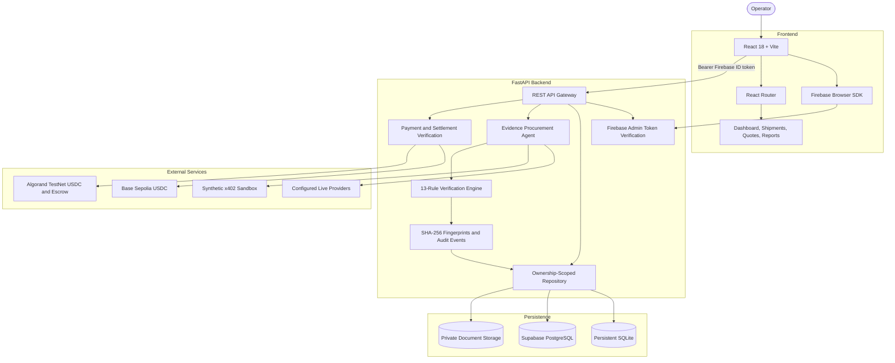
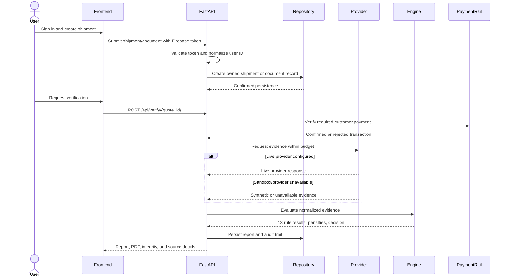
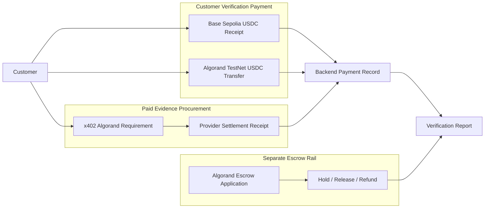

# CargoProof AI Architecture

## System Overview

## Request and Evidence Flow

## Payment Settlement Boundaries

Payment records, provider procurement receipts, escrow state, and verification reports remain separate. A confirmed payment unlocks its documented workflow; it does not prove physical custody, cargo condition, or successful verification.

## Storage Modes

| Mode | Data storage | Document storage | Authentication |
|---|---|---|---|
| Demo/SQLite | `backend/data/cargoproof.db` | Local private upload directory | Demo fallback or configured auth |
| Supabase | PostgreSQL through PostgREST | Private Supabase Storage | Firebase or configured backend validation |

Supabase service-role credentials are server-only. Repository queries must continue to scope data by authenticated user ID.

## 13-Rule Verification Engine

The engine evaluates submitted shipment fields and normalized provider evidence. Missing evidence never automatically passes a required check.

| Rule area | Examples |
|---|---|
| Container identity | ISO 6346 format and check digit |
| Vessel identity | Seven-digit IMO validity and checksum |
| AIS evidence | Position, speed, route, freshness |
| Ports and route | Loading/discharge, route sequence, plausibility |
| Weather | Arrival/departure marine conditions |
| Documents | SHA-256 integrity and extracted shipment fields |
| Cargo | Declared description and valuation consistency |
| Carrier coherence | Container, vessel, booking, and reference consistency |
| Customs/sanctions | Available screening and compliance evidence |

Severity is translated into rule penalties. A critical failure can reject a report, while non-critical failures may result in HOLD. Missing required evidence produces INSUFFICIENT_DATA; all required checks must pass for VERIFIED.

## API Trust Boundaries

- Firebase ID tokens are verified by the backend.
- Demo tokens are accepted only when demo authentication fallback is enabled.
- Shipment, quote, document, report, payment, and audit records are ownership-scoped.
- Private document records must not return storage paths or extracted text from public metadata listings.
- Report integrity is recomputed from persisted evidence fingerprints.
- Download endpoints require ownership validation.
- Administrative escrow actions require trusted authorization.

## Deployment Boundary

Current local operation uses React/Vite and FastAPI processes. Supabase and external provider configuration are optional integration boundaries.

Production deployment requires:

- Firebase and frontend domain configuration
- PostgreSQL or managed database hardening
- Private object-storage configuration
- Provider credentials and documented endpoints
- TestNet or mainnet network controls explicitly approved by operators
- Independent escrow contract review
- Shared rate limiting
- Secret management and centralized logging
- Backup, restore, and incident-response procedures
